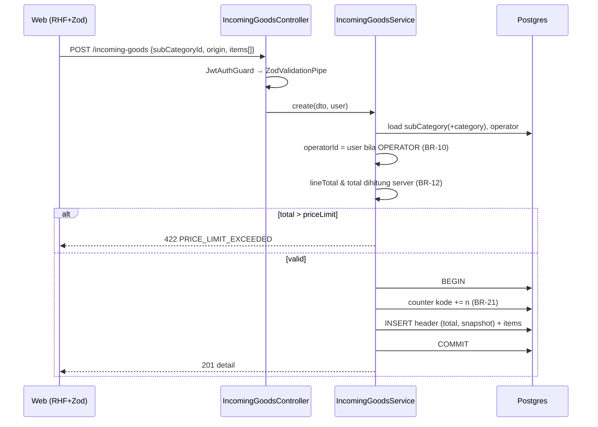

# ARCHITECTURE.md

Dokumen ini menjelaskan **struktur, keputusan (ADR), dan alur** sistem. Kontrak API: `API_SPEC.md`. Skema: `DATABASE_SCHEMA.md`.

---

## 1. Konteks & Driver Arsitektur

| Driver | Implikasi |
|---|---|
| Test **senior** dinilai dari kualitas, bukan jumlah fitur | Pemisahan layer jelas, validasi server-otoritatif, test aturan bisnis, dokumentasi |
| Wajib **deploy publik** di hosting gratis & dinilai langsung | Tangani cold start, tidak bergantung disk lokal, konfigurasi via env |
| Aturan bisnis kritis (batas harga, RBAC, lock) | Logika di service layer + constraint DB sebagai jaring pengaman |
| Dikerjakan dengan bantuan AI agent | Satu sumber kebenaran (Zod shared), konvensi ketat, dokumen konteks |

---

## 2. Topologi

```mermaid
flowchart LR
  U[Browser] -->|HTTPS| V[Vercel: Next.js web]
  V -->|rewrite /api/* (same-origin proxy)| R[Render: NestJS api]
  R -->|Prisma (pooled)| P[(Supabase Postgres)]
  R -->|service key| S[(Supabase Storage - private bucket)]
  G[GitHub Actions cron] -.->|GET /health tiap ~10 menit| R
```

- Browser **hanya** berbicara ke domain Vercel. Path `/api/*` di-proxy ke Render sehingga cookie `httpOnly` bersifat *same-origin* (tidak perlu `SameSite=None`, CORS praktis hanya dipakai di dev).
- Backend tidak pernah mengekspos secret DB/Storage ke browser. Lampiran diunduh via signed URL berumur 60 detik.

---

## 3. Architecture Decision Records

| ID | Keputusan | Alternatif & alasan |
|---|---|---|
| **ADR-01** | Monorepo **npm workspaces** (`apps/web`, `apps/api`, `packages/shared`), satu `package-lock.json` | Repo terpisah → skema validasi duplikat & drift. Monorepo membuat Zod schema satu sumber. npm dipilih karena sudah terpasang bersama Node.js (tanpa corepack/instalasi tambahan, penilai cukup `npm ci`) dan didukung native oleh Vercel & Render. pnpm lebih hemat disk dan ketat terhadap *phantom dependency*, namun menambah prasyarat tooling untuk repo sekecil ini; yarn tidak memberi keunggulan berarti. Konsekuensi: dependensi internal ditulis `"@jmc/shared": "*"` dan wajib disiplin mendeklarasikan dependensi di workspace yang memakainya (hoisting npm bisa menyembunyikan dependensi yang lupa dideklarasikan — dijaga oleh lint `import/no-extraneous-dependencies`) |
| **ADR-02** | **Prisma saja** (TypeORM dibuang dari rencana awal) | Dua ORM = ambigu bagi tim/agent. Prisma: tipe aman, migrasi deklaratif, DX baik |
| **ADR-03** | **JWT di cookie httpOnly** via proxy Next.js; header `Bearer` tetap diterima | `localStorage` rentan XSS. Cookie + `SameSite=Lax` + cek `Origin` untuk mutasi. Bearer dipertahankan untuk Swagger/test |
| **ADR-04** | Status user dicek ke DB **tiap request** (bukan hanya klaim JWT) | JWT stateless tidak bisa menerapkan *lock* seketika (BR-02). Biaya: 1 query ringan by PK |
| **ADR-05** | **Supabase Storage** (private) untuk lampiran | Disk lokal Render bersifat sementara → file hilang saat restart/deploy. Cloudinary alternatif valid tetapi menambah vendor |
| **ADR-06** | DB **Supabase Postgres**; `DATABASE_URL` pooled (runtime) + `DIRECT_URL` (migrasi) | Prisma + pooler butuh `pgbouncer=true`; migrasi butuh koneksi langsung. Neon adalah alternatif setara |
| **ADR-07** | Uang = **integer Rupiah** `NUMERIC(18,0)` | Hindari error float; Rupiah tanpa desimal |
| **ADR-08** | Export/Print di **server** (`exceljs`, `pdfmake`) | Konsisten dengan filter server; tanpa Chromium berat di free tier |
| **ADR-09** | **Server-side** paging/filter/sort; state tabel di **URL** | Skala data bisa besar; tautan dapat dibagikan & tahan refresh |
| **ADR-10** | **Keep-alive** + loading state untuk cold start | Free tier umumnya mematikan service saat idle dan DB bisa di-pause setelah tidak aktif; penilai tidak boleh menemui error. **Verifikasi batas free tier terkini saat deploy** |
| **ADR-11** | Aturan bisnis di **service layer**, ditambah `CHECK` constraint DB | Defense-in-depth: bug aplikasi tak bisa menyimpan data ilegal |
| **ADR-12** | Validasi dengan **Zod shared** + `nestjs-zod` (bukan class-validator) | FE & BE memakai skema identik; pesan error dapat diseragamkan |

---

## 4. Backend (NestJS)

### 4.1 Layering
```
HTTP → Guard (JwtAuth → Roles) → Pipe (Zod) → Controller → Service (aturan bisnis) → Prisma → DB
                                                         ↘ StorageService (Supabase)
Exception → AllExceptionsFilter → { error: { code, message, details, requestId } }
```
- **Controller**: routing, dekorator `@Roles`, parsing DTO. Tanpa logika.
- **Service**: seluruh BR (BR-05, 07–09, 10–18, 21, 23). Menerima `AuthUser` eksplisit (bukan membaca request global).
- **Prisma**: hanya dipanggil dari service/repository kecil. Gunakan `select` eksplisit.

### 4.2 Modul
| Modul | Tanggung jawab |
|---|---|
| `auth` | login/logout/me, `JwtStrategy` (cookie + bearer extractor), throttling login |
| `users` | CRUD, lock, guard BR-05 |
| `categories`, `sub-categories` | CRUD, options, guard BR-07/08 |
| `incoming-goods` | CRUD, scope Operator, BR-13, kode barang, verifikasi, export, print |
| `storage` | Wrapper Supabase Storage (upload, signed URL, delete) + validasi file |
| `health` | `/health` (cek DB) |
| `common` | `RolesGuard`, `@CurrentUser`, `AllExceptionsFilter`, `TransformInterceptor`, util `money`, `date` (WIB) |
| `config` | Validasi env (Zod) saat boot — gagal cepat bila env kurang |

### 4.3 Lintas-sektor
| Aspek | Implementasi |
|---|---|
| Keamanan HTTP | `helmet`, CORS allowlist (`CORS_ORIGINS`), `trust proxy`, cek `Origin` mutasi |
| Rate limiting | `@nestjs/throttler`: global longgar, `/auth/login` ketat |
| Password | `argon2id`; hash dummy untuk menyamakan waktu respons user-tidak-ada |
| Logging | `nestjs-pino`, `requestId`, redaksi `authorization`, `cookie`, `password` |
| Dokumentasi | Swagger dari DTO Zod di `/api/docs` |
| Graceful shutdown | `enableShutdownHooks()` → `prisma.$disconnect()` |

### 4.4 Alur: simpan Barang Masuk (BR-10, 12, 13, 21, 23)



### 4.5 Scope Operator (BR-18)
Satu helper `scopeByUser(user)` mengembalikan `{}` untuk Admin dan `{ operatorId: user.id }` untuk Operator. **Dipakai di list, years, export, detail, update, delete, print, attachment** — termasuk cek kepemilikan sebelum mutasi. Test e2e wajib mencakup semua endpoint tersebut.

### 4.5.1 Konkurensi
Pembaruan bersamaan: pada `PUT`, baca-ubah-tulis di dalam `$transaction`. Penguncian optimistik (`updatedAt`/`version` di body, `409 STALE_DATA`) adalah *nice-to-have* (ROADMAP P2).

### 4.6 File
`StorageService.validate(file)`: ekstensi ∈ {doc, docx, zip}; MIME sesuai; **magic bytes** (`D0 CF 11 E0` untuk `.doc`; `50 4B 03 04` untuk `.docx`/`.zip`); ukuran ≤ 4 MB; nama file disanitasi. Key penyimpanan: `incoming/{incomingGoodsId}/{uuid}.{ext}` — nama asli hanya disimpan di DB.

---

## 5. Frontend (Next.js)

### 5.1 Rute
```
/login
/(app)/layout.tsx            ← shell: Sidebar + Topbar, memuat /auth/me, guard role
/(app)/barang-masuk          ← daftar
/(app)/barang-masuk/baru     ← form tambah
/(app)/barang-masuk/[id]/edit
/(app)/master-data/kategori
/(app)/master-data/sub-kategori
/(app)/manajemen-user
```
`middleware.ts`: tanpa cookie sesi → redirect `/login` (hanya UX; otorisasi sesungguhnya di API). Role guard UI dari `/auth/me` (Operator ke rute admin → halaman 403).

### 5.2 Pola
| Topik | Pola |
|---|---|
| Server state | TanStack Query; `queryKey` terpusat; mutasi → `invalidateQueries` |
| State tabel | `useSearchParams` ⇄ `page, search, categoryId, subCategoryId, year, sortBy, sortOrder`; search di-*debounce* 400 ms; ubah filter/search → `page=1` |
| Form | React Hook Form + `zodResolver(schema dari shared)`; `useFieldArray` untuk item |
| Rupiah | `RupiahInput` (controlled): state = `number`, tampilan = `Intl.NumberFormat('id-ID')`; jaga posisi caret |
| Total live | `useWatch` item → total & sisa batas; indikator merah bila melebihi |
| Kategori→Sub | Saat kategori berubah: `reset subCategoryId`, query opsi `sub-categories/options?categoryId=` |
| Error server | Interceptor `api-client` memetakan `VALIDATION_ERROR.details[]` → `setError(field)`; `PRICE_LIMIT_EXCEEDED` → error form-level |
| Auth | 401 → hapus cache query → redirect `/login`; `ACCOUNT_LOCKED` → pesan khusus |
| Unduhan | Export/print dengan `fetch` + blob (cookie otomatis terkirim) |
| Cold start | Timeout klien ≥ 60 s untuk login/pertama; skeleton + pesan "Menghubungkan ke server…" bila >3 s |

### 5.3 Struktur fitur
```
features/incoming-goods/
  api/            (functions + query keys)
  components/     IncomingTable, FilterBar, IncomingForm, ItemRowsEditor, PriceLimitSummary, VerifyToggle
  hooks/          useIncomingList, useIncomingMutations
```
Komponen bersama: `DataTable`, `Pagination`, `SearchInput`, `RupiahInput`, `ConfirmDialog`, `FormField`, `EmptyState`, `PageHeader`.

---

## 6. Deployment

| Komponen | Layanan | Konfigurasi |
|---|---|---|
| Web | Vercel | Root `apps/web`; env `API_URL`; `next.config` rewrite `/api/:path*` → `${API_URL}/api/v1/:path*` |
| API | Render Web Service (Node) | Build: `npm ci --include=dev` + build shared + prisma generate + build api. Start: `npm run db:deploy && node apps/api/dist/main.js` (pre-deploy command biasanya tidak tersedia di free tier) |
| DB + Storage | Supabase | Pooler URL (runtime) & direct URL (migrasi); bucket `attachments` **private** |
| Keep-alive | GitHub Actions (cron) atau UptimeRobot | `GET /health` ± tiap 10 menit; juga mencegah pause DB |

Langkah rinci: `SETUP.md`. Batas free tier berubah-ubah — **cek halaman resmi masing-masing layanan sebelum deploy**.

---

## 7. Strategi Test

| Level | Cakupan wajib |
|---|---|
| Unit (Jest) | Kalkulasi total & BR-13 (batas tepat, +1), generator kode barang, password policy, mapper Decimal→number, util tahun WIB |
| Integrasi/e2e (Supertest + DB test) | Login (benar/salah/locked), RBAC matriks API_SPEC §9, scope Operator, CRUD Barang Masuk (happy path + 422 + terverifikasi 409), BR-05/07/08/09, upload lampiran invalid |
| FE (Vitest + RTL, opsional) | `RupiahInput`, `ItemRowsEditor` (tambah/hapus/total), validasi form |
| Smoke (Playwright, opsional) | Login → tambah transaksi → verifikasi → export |
| CI | GitHub Actions: install → lint → typecheck → test → build pada PR/push |

---

## 8. Risiko & Mitigasi

| Risiko | Dampak | Mitigasi |
|---|---|---|
| Cold start / DB pause saat penilaian | Penilai melihat error/lambat | ADR-10, loading state, cek `/health` sebelum submit & rekam video |
| Prisma + pooler: error prepared statement | Query gagal di produksi | `?pgbouncer=true` pada `DATABASE_URL`, `DIRECT_URL` untuk migrasi |
| Proxy Vercel membatasi ukuran body | Upload besar gagal | Batas lampiran 4 MB (AS-12); uji upload di produksi |
| Race kode barang | Duplikat `itemCode` | Counter atomik dalam transaksi (BR-21) + `UNIQUE` |
| Drift FE/BE | Bug validasi | Zod shared (ADR-12) |
| Kebocoran data antar Operator | Pelanggaran akses | `scopeByUser` + test e2e semua endpoint |
| Secret bocor di repo publik | Kompromi | `.env` di-ignore, hanya `.env.example`; secret di dashboard hosting |

---

## 9. Struktur Folder Referensi (apps/api/src)
```
common/{guards,filters,interceptors,decorators,utils}
config/env.ts
prisma/{prisma.module.ts,prisma.service.ts}
modules/incoming-goods/{incoming-goods.controller.ts, incoming-goods.service.ts,
  incoming-goods.query.ts (where/orderBy builder dipakai list+export),
  export/excel.builder.ts, print/pdf.builder.ts, incoming-goods.module.ts, *.spec.ts}
```
`incoming-goods.query.ts` adalah **satu-satunya** tempat membangun `where/orderBy` (BR-20).
